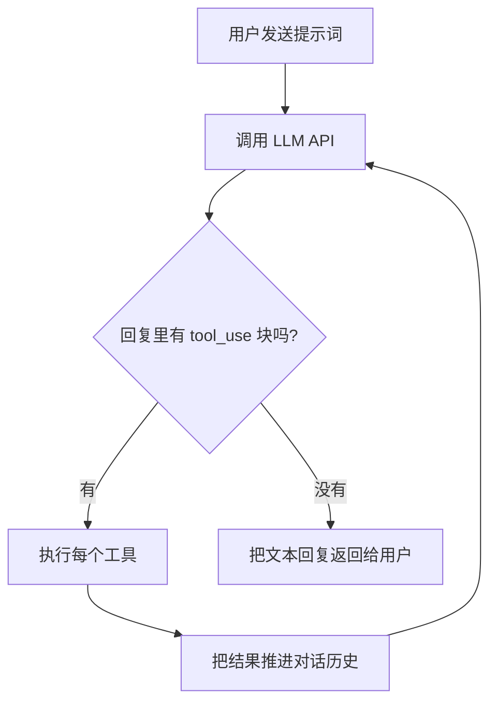

# 第 1 章：智能体循环

## 问题所在

用普通聊天机器人时，你发一条消息，得到一条回复，就结束了——一个回合。但编程任务从来不是一个回合能搞定的。"加个暗色模式开关"需要找文件、读文件、理解代码、改代码、跑测试，可能还要修复测试揪出来的问题。

那怎么让 AI 从一句提示词出发，把这一整套都做完呢？

## 真实任务长什么样

假设用户输入："给设置页面加一个暗色模式开关。"

一个 AI 编程智能体实际会这么干：

```
回合 1:  [工具] 搜索和设置相关的文件
回合 2:  [工具] 读取 Settings.tsx
回合 3:  [工具] 读取主题配置文件
回合 4:  [工具] 搜索已有的暗色模式代码
回合 5:  [工具] 编辑主题配置，加上暗色
回合 6:  [工具] 编辑 Settings.tsx，加个切换开关
回合 7:  [工具] 跑测试
回合 8:  [文本] "搞定。我给设置页加了一个暗色模式开关……"
```

八个回合，其中七个是工具调用，只有最后一个才是真正给用户看的文字。搜什么、读什么、改什么、什么时候算完事，全是模型自己决定的。

这就是"agentic（有能动性）"的含义。模型不只是在回答问题，它在做决策、采取行动，不断重复，直到任务完成。

## 什么是"工具"？

在看循环之前，先说清楚这里的"工具"指什么。

大多数 LLM API（Claude、GPT、Gemini 等）都支持一个叫"工具调用"或"函数调用"的功能。你可以告诉模型它能用哪些函数，比如"你有一个函数叫 `read_file`，接收一个文件路径，返回文件内容"。这些函数就叫**工具**。

模型自己并不会运行工具，它只能*请求*你去运行。当模型判断需要读文件时，它会回复一个特殊的块，叫 `tool_use`：

```json
{
  "type": "tool_use",
  "name": "read_file",
  "input": { "file_path": "src/App.tsx" }
}
```

这是模型在说："我想用这个输入调用 `read_file`，请你帮我运行一下，把结果告诉我。"

然后你的代码执行这个函数、拿到结果，再把结果作为一个 `tool_result` 块发回给模型。"执行这个函数"具体是什么样？说到底，就是一个函数：

```typescript
function executeTool(name: string, input: Record<string, string>): string {
  if (name === "read_file") {
    return fs.readFileSync(input.file_path, "utf-8");
  }
  if (name === "list_files") {
    return fs.readdirSync(input.directory).join("\n");
  }
  return "未知工具";
}
```

工具就是一个函数。模型说"用这个路径调用 `read_file`"，你的代码从磁盘读文件，再把内容发回去。仅此而已。第 2 章我们会搭建一套像样的工具，包括怎么组织它们、校验输入、处理错误。眼下这些就够你看懂下面的循环了。

## 循环

整个东西就是一个包在函数里的 `while(true)` 循环。首先，你初始化 API 客户端，并定义模型能用哪些工具：

```typescript
import Anthropic from "@anthropic-ai/sdk";

const client = new Anthropic(); // 从环境变量读取 ANTHROPIC_API_KEY

// 告诉模型它有哪些工具（第 2 章会详细讲）
const tools: Anthropic.Tool[] = [
  {
    name: "get_time",
    description: "获取当前日期和时间",
    input_schema: { type: "object", properties: {}, required: [] },
  },
];
```

每个工具都有一个 `name`、一个 `description`（让模型知道它是干什么的），以及一个描述它接收哪些参数的 `input_schema`。schema 用的是 [JSON Schema](https://json-schema.org/) 格式。`properties` 列出参数及其类型，`required` 列出哪些是必填的。这个 `get_time` 工具不接收任何参数，所以两个都是空的。一个读文件的工具会长这样：

```typescript
{
  name: "read_file",
  description: "从磁盘读取一个文件",
  input_schema: {
    type: "object",
    properties: {
      file_path: { type: "string", description: "文件路径" },
    },
    required: ["file_path"],
  },
}
```

模型读到这些定义，就知道："我可以用一个 `file_path` 字符串来调用 `read_file`。"第 2 章我们会搭建真正的工具。

然后是智能体循环本身：

```typescript
async function agentLoop(
  conversationHistory: Anthropic.MessageParam[]
): Promise<string> {
  while (true) {
    // 1. 把对话发给 API
    const response = await client.messages.create({
      model: "claude-sonnet-4-20250514",
      max_tokens: 4096,
      tools,
      messages: conversationHistory,
    });

    // 2. 把助手的回复加进历史
    conversationHistory.push({ role: "assistant", content: response.content });

    // 3. 检查模型有没有用工具
    const toolUseBlocks = response.content.filter(
      (block): block is Anthropic.ToolUseBlock => block.type === "tool_use"
    );

    if (toolUseBlocks.length === 0) {
      // 没调用工具，模型干完了。提取文本返回。
      const textBlocks = response.content.filter(
        (block): block is Anthropic.TextBlock => block.type === "text"
      );
      return textBlocks.map((b) => b.text).join("\n");
    }

    // 4. 执行每个工具，收集结果
    const toolResults: Anthropic.ToolResultBlockParam[] = [];
    for (const toolUse of toolUseBlocks) {
      const result = executeTool(toolUse.name, toolUse.input);
      toolResults.push({
        type: "tool_result",
        tool_use_id: toolUse.id,
        content: result,
      });
    }

    // 5. 把工具结果作为一条 user 消息推回对话
    conversationHistory.push({ role: "user", content: toolResults });

    // 6. 回到第 1 步
  }
}
```

整个架构就这些。这个函数接收对话历史，一直循环直到模型不再调用工具，然后返回最终的文本回复。本指南里其余的一切，都是在这个循环之上添加功能。

## 一步一步看它怎么运转

我们跟着走一遍，看看用户说"读一下 README 文件"时发生了什么：

**第 1 步**：我们把对话发给 API。messages 数组长这样：

```json
[
  { "role": "user", "content": "read the README file" }
]
```

**第 2 步**：API 返回一个 `tool_use` 块：

```json
{
  "content": [
    {
      "type": "tool_use",
      "id": "toolu_abc123",
      "name": "read_file",
      "input": { "file_path": "README.md" }
    }
  ],
  "stop_reason": "tool_use"
}
```

**第 3 步**：我们看到一个 `tool_use` 块，所以不退出循环。我们执行工具（读文件），拿回内容。

**第 4 步**：我们把工具结果作为一条 user 消息推回去：

```json
[
  { "role": "user", "content": "read the README file" },
  { "role": "assistant", "content": [{ "type": "tool_use", ... }] },
  { "role": "user", "content": [{ "type": "tool_result", "tool_use_id": "toolu_abc123", "content": "# My Project\n..." }] }
]
```

**第 5 步**：我们回到第 1 步。现在模型同时看到了自己的工具调用*和*结果，文件内容就摆在它面前。它现在可以决定：是要再调一个工具，还是可以用文字回复了？

如果它只回文字（没有 `tool_use` 块），循环退出，完事。

如果它又调了一个工具，我们就重复这个循环。

## 流程



这就是完整的智能体循环。每个 AI 编程智能体都是这么工作的。简单智能体和生产级智能体的区别，全在接下来几章里我们围绕这个循环添加的东西。

## 检查 tool_use 块，而不是 stop_reason

你可能觉得应该靠 `response.stop_reason === "tool_use"` 来判断有没有调用工具。别依赖这个。`stop_reason` 这个字段并不总是可靠。有时候回复里明明有工具调用，它却说 `end_turn`。

应该去检查实际的内容：

```typescript
const toolUseBlocks = response.content.filter(
  block => block.type === "tool_use"
);

if (toolUseBlocks.length === 0) {
  break; // 没有工具，我们干完了
}
```

生产级智能体就是这么做的。看模型实际返回了什么，而不是看元数据怎么说。

## 退出条件

循环不会永远跑下去。有好几种停下来的理由：

| 条件 | 会发生什么 |
|---|---|
| **没有工具调用** | 模型只回了文字，它判断自己干完了。这是正常退出。 |
| **达到最大回合数** | 安全上限。如果模型已经循环了 50 个回合，多半是出问题了，跳出来。 |
| **用户取消** | 用户按了 Ctrl+C，或者触发了中止信号。 |
| **上下文太长** | 对话历史太大，超出了模型的上下文窗口。第 6 章会处理这个。 |
| **API 报错** | 模型返回了错误（限流、服务器错误等）。 |

生产级智能体还有更多退出条件，但这五个涵盖了最重要的几种。

眼下我们只实现前两个（没有工具调用 = 干完了，达到最大回合数 = 安全停止）。其余的随着推进再加。

## 关键洞见

"智能体"这个词听起来好像很复杂，其实不是。模型这一回合的输出，变成下一回合它自己的输入。整个把戏就在这儿。循环不做决策，模型才做。循环只是不停地问"接下来呢？"，模型不停地回答，直到它决定停下来。

```
模型输出 --> 工具结果 --> 模型输入（下一回合）
```

循环是笨的，模型是聪明的。你的活儿就是给模型工具（下一章），然后让循环转起来。

## 还缺什么

我们的循环没有任何工具。模型读不了文件、搜不了代码、跑不了命令，只能回文字。下一章，我们给它装上眼睛和手。

## REPL

我们有了 `agentLoop()`，但还需要一个途径让用户输入消息、看到回复。示例里用了一个简单的 REPL（读取-求值-打印循环），基于 Node 的 `readline` 模块：

```typescript
import * as readline from "readline";

async function main() {
  const conversationHistory: Anthropic.MessageParam[] = [];

  const rl = readline.createInterface({
    input: process.stdin,
    output: process.stdout,
  });

  const ask = () => {
    rl.question("> ", async (input) => {
      const trimmed = input.trim();
      if (!trimmed) return ask();

      // 把用户消息加进历史
      conversationHistory.push({ role: "user", content: trimmed });

      // 运行智能体循环
      const response = await agentLoop(conversationHistory);
      console.log(`\n${response}\n`);

      // 询问下一条消息
      ask();
    });
  };

  ask();
}

main();
```

用户输入一条消息，它被加进对话历史，智能体循环开始运行（可能多次调用工具），最后打印出文本回复。然后 REPL 又来问下一条消息。对话历史会一直往下传，所以后续消息都带着完整的上下文。

这个 REPL 就是包在智能体循环外面的一层壳。本指南里的每个示例都用这同一套模式。

## 运行示例

```bash
npm run example:01
```

示例用了一个 `get_time` 工具，好让你看到这个循环实际跑起来的样子。试试"现在几点了？"，看模型调用工具并用上结果。
