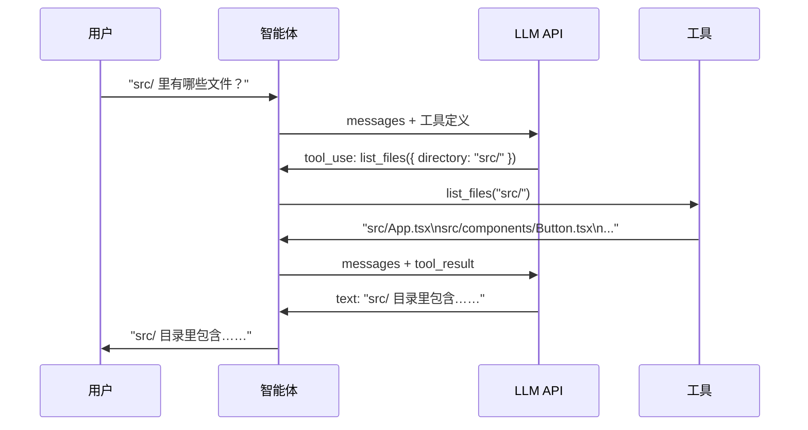

# 第 2 章：工具

## 问题所在

第 1 章里的智能体有脑子，但没有身体。它能思考、能说话，却看不到你的文件、搜不了你的代码、跑不了命令。没有工具，它就只是个聊天机器人。

工具是模型与现实世界打交道的方式。每个工具都是模型能调用的一个函数。"读这个文件。""搜这个模式。""跑这个命令。"模型挑用哪个工具、传什么参数，由我们来执行。

## 走一遍："README 里写了什么？"

用户输入："README 里写了什么？"

没有工具，模型只能靠猜。有了 `read_file` 工具，过程是这样的：

```
回合 1:
  模型心想: "我得读一下文件才能回答。"
  模型调用:  read_file({ file_path: "README.md" })
  我们执行:  fs.readFileSync("README.md", "utf-8")
  我们返回:  "# My Project\nA simple React app..."

回合 2:
  模型看到:  自己的工具调用 + 文件内容
  模型说:    "README 里是一段项目描述……"
  没有调用工具。循环退出。
```

两个回合，一次工具调用。模型决定去读文件、拿到内容、回答了问题。我们没让它用读取工具，是它自己琢磨出来的。

## 工具的接口

每个工具都需要两样东西：

1. **一个定义**，告诉模型这个工具是干什么的（名字、描述，以及它接收什么输入）
2. **一个实现**，真正把活儿干了

定义就是模型看到的东西。它用 JSON Schema 来描述输入格式。一个 `read_file` 工具的定义发给 API 时长这样：

```json
{
  "name": "read_file",
  "description": "读取一个文件的内容。",
  "input_schema": {
    "type": "object",
    "properties": {
      "file_path": {
        "type": "string",
        "description": "要读取的文件路径"
      }
    },
    "required": ["file_path"]
  }
}
```

模型读到这个就知道："我可以用一个 `file_path` 字符串来调用 `read_file`。"模型需要的就这些。

在我们这一侧，我们需要组织好工具，并校验模型发来的输入（它会犯错）。我们用一个简单的接口：

```typescript
interface Tool {
  name: string;
  description: string;
  inputSchema: z.ZodObject<any>;
  call(input: Record<string, unknown>): Promise<string>;
}
```

这里的 `inputSchema` 用了 [Zod](https://zod.dev/)，一个 TypeScript 校验库。我们用它有两个理由：它能在运行时校验模型的输入（在坏参数引发错误之前就抓住），而且我们能把它转成 API 需要的 JSON Schema 格式。你也可以直接用纯 JSON Schema，但 Zod 让校验更省事。

模型调用工具时，我们先用 Zod 校验输入。如果不对，就把一个错误发回去，而不是直接崩掉。

## 必备的几个工具

覆盖大多数编程任务，你只需要几个工具：

| 工具 | 作用 | 举例 |
|---|---|---|
| **read_file** | 从磁盘读取文件 | 读 "src/App.tsx" |
| **write_file** | 创建或覆盖文件 | 创建 "src/utils.ts" |
| **edit_file** | 替换文件里某个特定字符串 | 把 "blue" 改成 "red" |
| **run_command** | 执行 shell 命令 | 跑 "npm test" |
| **list_files** | 按模式查找文件 | 找所有 "*.tsx" 文件 |
| **search_files** | 用正则搜索文件内容 | 在所有文件里找 "useState" |

有这六个工具，一个智能体几乎能干开发者干的所有事。编辑工具足够特别，值得单独一章（第 3 章）。眼下我们先把其余五个搭出来。

## 搭建工具

### read_file

最简单、用得最多的工具。模型会不停地调它。

```typescript
const readFileTool: Tool = {
  name: "read_file",
  description: "读取一个文件的内容。返回带行号的文件内容。",
  inputSchema: z.object({
    file_path: z.string().describe("要读取的文件路径"),
  }),
  async call(input) {
    const content = fs.readFileSync(input.file_path as string, "utf-8");
    const lines = content.split("\n");
    // 加上行号，方便模型之后引用具体某一行
    return lines.map((line, i) => `${i + 1}\t${line}`).join("\n");
  },
};
```

我们给输出加了行号。这能帮模型在之后想做编辑时引用具体的行。是件小事，但差别很大。

### run_command

运行一个 shell 命令并返回输出。这个工具强大又危险，正因如此才有了第 7 章（权限）。

```typescript
const runCommandTool: Tool = {
  name: "run_command",
  description: "运行一个 shell 命令并返回其输出。",
  inputSchema: z.object({
    command: z.string().describe("要运行的 shell 命令"),
  }),
  async call(input) {
    try {
      const output = execSync(input.command as string, {
        encoding: "utf-8",
        timeout: 30_000,   // 30 秒超时
        maxBuffer: 1024 * 1024,  // 最多 1MB 输出
      });
      return output;
    } catch (err: any) {
      return `错误（退出码 ${err.status}）: ${err.stderr || err.message}`;
    }
  },
};
```

注意那个超时和最大缓冲区。没有它们，像 `yes` 这种（会永远打印"y"）的命令会把你的智能体卡死。shell 命令一定要加上限制。

### list_files

列出某个目录里的文件。模型用它在读具体文件之前先摸清代码库。

```typescript
const listFilesTool: Tool = {
  name: "list_files",
  description: "递归列出一个目录里的文件。跳过 node_modules 和隐藏文件。",
  inputSchema: z.object({
    directory: z.string().optional().describe("要列出的目录。默认为当前目录。"),
  }),
  async call(input) {
    const dir = (input.directory as string) || ".";
    const files: string[] = [];

    function walk(d: string) {
      for (const entry of fs.readdirSync(d, { withFileTypes: true })) {
        if (entry.name.startsWith(".") || entry.name === "node_modules") continue;
        const full = path.join(d, entry.name);
        if (entry.isDirectory()) walk(full);
        else files.push(full);
      }
    }

    walk(dir);
    return files.join("\n") || "(空目录)";
  },
};
```

我们跳过了 `node_modules` 和隐藏文件。不加这个过滤，模型会被成千上万个无关文件淹没。

### search_files

用正则模式搜索文件内容。像 `grep`，但返回的是模型能用的结果。

```typescript
const searchFilesTool: Tool = {
  name: "search_files",
  description: "在文件里搜索某个模式。返回匹配的行，带文件路径和行号。",
  inputSchema: z.object({
    pattern: z.string().describe("要搜索的正则模式"),
    directory: z.string().optional().describe("要搜索的目录。默认为当前目录。"),
  }),
  async call(input) {
    const dir = (input.directory as string) || ".";
    const regex = new RegExp(input.pattern as string);
    const results: string[] = [];

    function search(d: string) {
      for (const entry of fs.readdirSync(d, { withFileTypes: true })) {
        if (entry.name.startsWith(".") || entry.name === "node_modules") continue;
        const full = path.join(d, entry.name);
        if (entry.isDirectory()) {
          search(full);
        } else {
          try {
            const lines = fs.readFileSync(full, "utf-8").split("\n");
            lines.forEach((line, i) => {
              if (regex.test(line)) {
                results.push(`${full}:${i + 1}: ${line.trim()}`);
              }
            });
          } catch {
            // 跳过读不了的文件（二进制文件等）
          }
        }
      }
    }

    search(dir);
    return results.slice(0, 50).join("\n") || "没有找到匹配项。";
  },
};
```

我们把结果限制在 50 行。不加限制，像 `import` 这种常见模式可能返回成千上万个匹配，把模型的上下文窗口吃光。

### write_file

创建一个新文件，或覆盖一个已有文件。对已有文件的编辑，我们会用编辑工具（第 3 章）。这个工具是用来创建新文件的。

```typescript
const writeFileTool: Tool = {
  name: "write_file",
  description: "把内容写入一个文件。文件不存在就创建，存在就覆盖。",
  inputSchema: z.object({
    file_path: z.string().describe("要写入的文件路径"),
    content: z.string().describe("要写入的内容"),
  }),
  async call(input) {
    const filePath = input.file_path as string;
    fs.mkdirSync(path.dirname(filePath), { recursive: true });
    fs.writeFileSync(filePath, input.content as string);
    return `文件已写入: ${filePath}`;
  },
};
```

## 把工具接入循环

现在把工具接进第 1 章的智能体循环。首先，把所有工具收进一个数组：

```typescript
const tools: Tool[] = [
  readFileTool,
  writeFileTool,
  listFilesTool,
  searchFilesTool,
  runCommandTool,
];
```

然后有两处要改：

**1. 把工具注册给 API。**我们把 Zod schema 转成 JSON Schema，通过 `tools` 参数传进去：

```typescript
const apiTools = tools.map(tool => ({
  name: tool.name,
  description: tool.description,
  input_schema: zodToJsonSchema(tool.inputSchema),
}));

const response = await client.messages.create({
  model: "claude-sonnet-4-20250514",
  max_tokens: 4096,
  tools: apiTools,
  messages: conversationHistory,
});
```

**2. 找到并执行对应的工具。**模型返回一个 `tool_use` 块时，我们按名字查到工具、校验输入、调用它：

```typescript
for (const toolUse of toolUseBlocks) {
  const tool = tools.find(t => t.name === toolUse.name);
  if (!tool) {
    toolResults.push({
      type: "tool_result",
      tool_use_id: toolUse.id,
      content: `未知工具: ${toolUse.name}`,
      is_error: true,
    });
    continue;
  }

  // 校验输入
  const parsed = tool.inputSchema.safeParse(toolUse.input);
  if (!parsed.success) {
    toolResults.push({
      type: "tool_result",
      tool_use_id: toolUse.id,
      content: `无效输入: ${parsed.error.message}`,
      is_error: true,
    });
    continue;
  }

  // 执行工具
  const result = await tool.call(parsed.data);
  toolResults.push({
    type: "tool_result",
    tool_use_id: toolUse.id,
    content: result,
  });
}
```

注意那个 `is_error: true` 标记。当一次工具调用失败时（未知工具、无效输入、运行时错误），我们仍然返回一个结果，只是把它标记为错误。模型看到错误，可以重试，也可以换个思路。永远别崩溃，永远返回点什么。

## 流程



## 真实会话里会发生什么

用户问"Button 组件是干什么的？"时，一个多工具会话长这样：

```
> what does the Button component do?

  [tool] list_files({ directory: "sample-project/src" })
  [result] sample-project/src/App.tsx
           sample-project/src/components/Button.tsx
           sample-project/src/components/Header.tsx

  [tool] read_file({ file_path: "sample-project/src/components/Button.tsx" })
  [result] 1  interface ButtonProps {
           2    label?: string;
           3    onClick?: () => void;
           4  }
           ...

Button 组件是一个可复用的按钮，接收一个 label
和一个 onClick 处理函数……
```

模型搜文件、找到了 Button 组件、读了它、解释了它。三个回合，两次工具调用，一次文本回复。我们从没告诉它读哪个文件，它从文件列表里自己琢磨出来的。

## 还缺什么

模型能读文件，但还不能编辑它们。下一章，我们来搭建编辑工具。而它编辑文件的方式，多半出乎你意料。

## 运行示例

```bash
npm run example:02
```

试试这些提示词：
- "What files are in the sample project?"
- "Read the Button component"
- "Search for className in the sample project"
