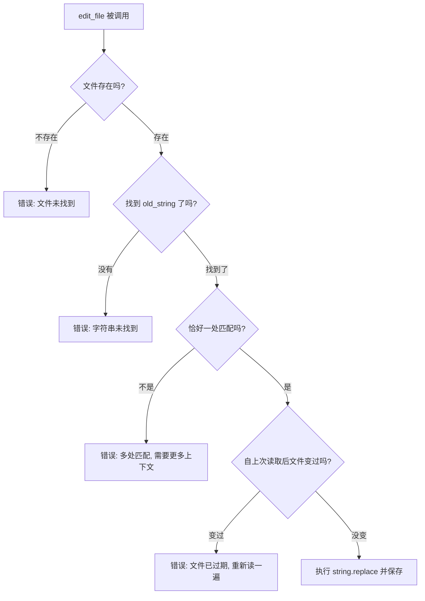

# 第 3 章：编辑工具

## 问题所在

模型现在能读文件了。但它怎么编辑文件呢？

你可能以为会是什么复杂的东西。也许它把代码解析成 AST（抽象语法树）然后操作节点，也许它用某种 diff 算法，也许它靠行号去插入或删除特定的行。

这些它都不干。它用的是 `string.replace()`。整个事情就这么点。

## 走一遍："把按钮颜色改成红色"

用户输入："把示例项目里的按钮颜色改成红色。"

过程是这样的：

```
回合 1:
  [tool] list_files({ directory: "sample-project/src" })
  [result] sample-project/src/App.tsx
           sample-project/src/components/Button.tsx
           sample-project/src/components/Header.tsx

回合 2:
  [tool] read_file({ file_path: "sample-project/src/components/Button.tsx" })
  [result] 1   interface ButtonProps {
           2     label?: string;
           3     onClick?: () => void;
           4   }
           5
           6   export function Button({ label = "Get Started", onClick }: ButtonProps) {
           7     return (
           8       <button
           9         onClick={onClick}
           10        className="bg-blue-500 text-white px-6 py-2 rounded-lg hover:bg-blue-600"
           11      >
           12        {label}
           13      </button>
           14    );
           15  }

回合 3:
  [tool] edit_file({
    file_path: "sample-project/src/components/Button.tsx",
    old_string: "bg-blue-500 text-white px-6 py-2 rounded-lg hover:bg-blue-600",
    new_string: "bg-red-500 text-white px-6 py-2 rounded-lg hover:bg-red-600"
  })
  [result] Edited sample-project/src/components/Button.tsx

回合 4:
  [text] "我把按钮颜色从蓝色改成了红色……"
```

模型搜文件、读了 button 组件、把旧字符串换成了新字符串。底层上，编辑工具干的就是这事：

```typescript
const updated = fileContent.replace(oldString, newString);
fs.writeFileSync(filePath, updated);
```

就这样。`string.replace()`。

有个小细节：生产级的实现会用一个回调函数来做替换（`content.replace(search, () => replace)`），而不是直接传字符串。这样能防止 JavaScript 把替换字符串里像 `$1` 或 `$&` 这样的特殊模式给解释掉。万一用户的新代码里正好有 `$1`，你可不想它被当成正则的捕获组引用。

## 为什么 string.replace() 行得通

看着是太简单了，但这套做法能胜出是有道理的：

**行号会漂移。**如果你编辑第 10 行，后面每一行都往下挪。模型要是想做两处编辑，第二处的行号就全错了。字符串替换没这个问题，它找的是确切的文本，不管它在哪儿。

**AST 解析是分语言的。**JavaScript、Python、Rust、HTML、CSS、YAML、Markdown，以及其他每一种语言，你都得有个不同的解析器。字符串替换对任何文件都管用，连二进制配置文件都行。

**模型擅长这个。**语言模型天生就擅长输出确切的文本。"找到这个字符串，换成那个字符串"这种任务它们处理得很好。

## 唯一性问题

有一个坑。要是那个字符串出现了不止一次呢？

```tsx
// 这个文件有两个按钮，都是 bg-blue-500
<button className="bg-blue-500">Save</button>
<button className="bg-blue-500">Cancel</button>
```

如果模型发来 `old_string: "bg-blue-500"`，我们该替换哪一个？不知道。所以我们拒绝这次编辑。

规则很简单：**old_string 必须在文件里恰好出现一次。**如果出现零次，说明没找到这个字符串。如果出现超过一次，匹配就有歧义。两种都算错误。

```typescript
const editFileTool: Tool = {
  name: "edit_file",
  description:
    "通过把 old_string 替换为 new_string 来编辑一个文件。" +
    "old_string 必须在文件里恰好出现一次。" +
    "包含足够多的上下文，让匹配唯一。",
  inputSchema: z.object({
    file_path: z.string().describe("要编辑的文件路径"),
    old_string: z.string().describe("要查找的确切文本"),
    new_string: z.string().describe("替换成的文本"),
    replace_all: z.boolean().optional().describe("替换所有出现处"),
  }),
  async call(input) {
    const filePath = input.file_path as string;
    const oldString = input.old_string as string;
    const newString = input.new_string as string;
    const content = fs.readFileSync(filePath, "utf-8");

    // 统计出现次数
    const count = content.split(oldString).length - 1;

    if (count === 0) {
      return "错误：在文件里没有找到 old_string。";
    }

    if (count > 1) {
      return `错误：找到了 ${count} 处匹配。请包含更多上下文，让匹配唯一。`;
    }

    // 恰好一处匹配。可以安全替换。
    const updated = content.replace(oldString, newString);
    fs.writeFileSync(filePath, updated);
    return `已编辑 ${filePath}`;
  },
};
```

当模型收到"找到 3 处匹配"这个错误时，它就知道自己得包含更多上下文了。它不会只发 `"bg-blue-500"`，而是会发：

```json
{
  "old_string": "<button className=\"bg-blue-500\">Save</button>",
  "new_string": "<button className=\"bg-red-500\">Save</button>"
}
```

现在匹配唯一了，编辑就通过了。

还有一个 `replace_all` 选项，用于你确实想替换每一处出现的情况。但默认是要求唯一性的，这能防止误改。

单处替换使用回调：`content.replace(actualString, () => newString)`。直接传字符串时，JavaScript 会把 `$&`、`$1` 等当作替换语法；模型给出的新代码应按原文写入，回调能保留这些字符。

## 校验流程



## 引号归一化

有个微妙的问题。有时候模型会输出弯引号（ “ ” ）而不是直引号（ " ）。这是因为模型是在使用弯引号的文本上训练出来的。如果文件里是直引号，而模型发来弯引号，那即便文本"看起来"一样，匹配也会失败。

解决办法：先试确切匹配。如果失败，就把搜索字符串和文件内容都归一化（把所有弯引号转成直引号），再试一次。如果归一化后的版本匹配上了，就用归一化匹配的位置去文件里定位原始文本。

```typescript
function findActualString(fileContent: string, searchString: string): string | null {
  // 先试确切匹配
  if (fileContent.includes(searchString)) {
    return searchString;
  }

  // 用归一化后的引号再试
  const normalize = (s: string) =>
    s.replace(/[\u2018\u2019]/g, "'").replace(/[\u201C\u201D]/g, '"');

  const normalizedFile = normalize(fileContent);
  const normalizedSearch = normalize(searchString);

  const index = normalizedFile.indexOf(normalizedSearch);
  if (index !== -1) {
    // 返回文件里的原始文本（带原本的引号）
    return fileContent.substring(index, index + searchString.length);
  }

  return null;
}
```

这是件小事，但能省掉一堆让人抓狂的失败——编辑"本该"成功却偏偏不成功。

## 过期检测

要是智能体干活时，用户手动改了文件呢？模型五个回合前读了文件，它上下文里是旧版本，它基于旧版本发来一次编辑。可磁盘上的文件已经变了。

如果我们照样应用这次编辑，可能会覆盖掉用户的改动。那可糟了。

解决办法：记录模型上次读每个文件的时间。应用编辑之前，检查文件自那之后有没有被改过。如果改过，就拒绝这次编辑，让模型重新读一遍文件。

```typescript
// 记录每个文件被模型上次读取的时间
const readTimestamps = new Map<string, number>();

// 在 read_file 工具里:
readTimestamps.set(filePath, Date.now());

// 在 edit_file 工具里:
const lastRead = readTimestamps.get(filePath);
if (lastRead) {
  const stat = fs.statSync(filePath);
  if (stat.mtimeMs > lastRead) {
    return "错误：自你上次读取后，文件已被修改。请先重新读一遍。";
  }
}
```

这是个简化版。生产级智能体会更进一步：它们还会比对文件内容（不只是时间戳），因为有些系统会在内容没变的情况下更新时间戳（云同步、杀毒扫描）。完整的检查是：如果时间戳变了，就再比对内容，只有内容确实不同时才拒绝。

## 还缺什么

模型现在能搜、能读、能编辑文件了。但它并不总是做出聪明的选择。有时它不去搜索，而是猜文件路径。有时它想编辑一个它还没读过的文件。下一章，我们用一段系统提示词来解决这个问题，教模型该怎么做事。

## 运行示例

```bash
npm run example:03
```

试试这些提示词：
- "Change the button color to red in the sample project"
- "Change the header title default from 'My App' to 'Hello World' in the sample project"
- "Change the heading size from text-2xl to text-4xl in the sample project"
