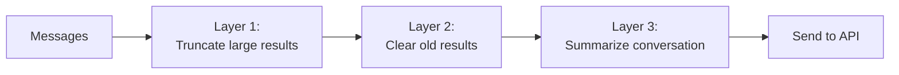

# 第 6 章：上下文压缩

## 问题

跟 AI 编程智能体进行一段 50 轮的对话，轻轻松松就能到 200,000 token。每读一个文件都会往历史里灌几千个 token。每个工具结果都永远留在那儿。而每次 API 调用又要把整段历史发过去。

到了某个节点，你会撞上上下文窗口上限，API 调用就失败了。在那之前，你每一次调用都在为那些陈旧的 token 付费。

你需要一种办法，在不丢掉重要部分的前提下缩小对话。

## 压缩流水线

生产级智能体不会只用一种压缩策略。它们是分层的，从最便宜到最贵：



每一层都在每次 API 调用之前运行。它们按成本排序：

- **便宜**指的是它只在内存里摆弄字符串。没有 API 调用，没有额外 token，毫秒级就跑完。截断一个字符串，或者把旧文本替换成“[已清除]”，这就是便宜。
- **昂贵**指的是它会额外发一次 LLM 调用，要花 token，要花好几秒。让模型去总结对话，这就是昂贵。

便宜的层先跑，处理掉大多数情况。昂贵的层只在便宜的层不够用时才启动。

## 第 1 层：截断大的工具结果

最便宜的压缩。有些工具结果非常大。读一个 5,000 行的文件，会把它整个灌进对话。但模型通常只需要开头那部分（用来理解结构），或者某个特定片段（用来做修改）。

解决办法：给工具结果设一个字符数上限。如果某个结果超了，就保留开头一段，再加一句说明，告诉它被截断了。

```typescript
const MAX_RESULT_CHARS = 10_000;

function truncateResult(result: string): string {
  if (result.length <= MAX_RESULT_CHARS) {
    return result;
  }
  const truncated = result.slice(0, MAX_RESULT_CHARS);
  return (
    truncated +
    `\n\n[已截断：结果原有 ${result.length} 个字符。` +
    `仅显示前 ${MAX_RESULT_CHARS} 个。]`
  );
}
```

你在智能体循环里调用它，就在工具结果被收集、准备推入对话之前：

```typescript
// 在智能体循环里，执行完一个工具之后：
const result = await tool.call(parsed.data);
const truncatedResult = truncateResult(result);  // <-- 存储前先应用

toolResults.push({
  type: "tool_result",
  tool_use_id: toolUse.id,
  content: truncatedResult,
});
```

实际跑起来是这样的。模型读了一个大文件：

```
截断前（25,000 个字符）：

  1   import express from "express";
  2   import cors from "cors";
  3   ...
  ... (还有 500 行)
  502 export default app;

截断后（10,000 个字符）：

  1   import express from "express";
  2   import cors from "cors";
  3   ...
  ... (前 ~200 行)

  [已截断：结果原有 25,000 个字符。仅显示前 10,000 个。]
```

模型看到了文件的一部分，足以理解它的结构（imports、exports、主要模式），而不用让完整的 500 行把上下文吃光。如果它之后需要某个特定片段，可以带一个 offset 再读一次文件。

**何时触发：** 每一轮，对每一个工具结果。

**成本是多少：** 没有成本。就是切切字符串。

## 第 2 层：清除旧的工具结果

20 轮之前的工具结果，很少还有用。模型读了个文件，用过那些信息，然后就往下走了。把完整文件内容留在对话里纯属浪费。

解决办法：把旧的工具结果替换成一小段占位文本。

```typescript
const KEEP_RECENT = 6; // 保留最近 N 个工具结果不动

function clearOldResults(
  messages: Anthropic.MessageParam[]
): Anthropic.MessageParam[] {
  // 找出所有工具结果消息及其位置
  const toolResultPositions: number[] = [];
  messages.forEach((msg, i) => {
    if (typeof msg.content !== "string" && Array.isArray(msg.content)) {
      const hasToolResult = msg.content.some(
        (block: any) => block.type === "tool_result"
      );
      if (hasToolResult) toolResultPositions.push(i);
    }
  });

  // 保留最近的那些，其余清除
  const toClear = toolResultPositions.slice(0, -KEEP_RECENT);

  return messages.map((msg, i) => {
    if (!toClear.includes(i)) return msg;

    // 用占位文本替换工具结果内容
    const content = (msg.content as any[]).map((block: any) => {
      if (block.type === "tool_result") {
        return {
          ...block,
          content: "[先前的工具结果已清除以节省上下文]",
        };
      }
      return block;
    });

    return { ...msg, content };
  });
}
```

来看看实际效果。假设对话里有 10 个工具结果，我们保留最近的 6 个：

```
清除前（10 个工具结果，保留最近 6 个）：

  list_files    → "src/App.tsx\nsrc/Button..."       (500 字符)      ← 清除
  read_file     → "1  import React from...'         (20,000 字符)   ← 清除
  read_file     → "1  export function Button..."    (5,000 字符)    ← 清除
  search_files  → "src/App.tsx:3: import..."        (2,000 字符)    ← 清除
  edit_file     → "Edited src/App.tsx"              (20 字符)       ← 保留
  read_file     → "1  import express from..."       (12,000 字符)   ← 保留
  search_files  → "src/routes.ts:12: app.get..."    (1,500 字符)    ← 保留
  read_file     → "1  const router = ..."           (8,000 字符)    ← 保留
  edit_file     → "Edited src/routes.ts"            (22 字符)       ← 保留
  run_command   → "Tests passed"                    (15 字符)       ← 保留

清除后：

  list_files    → "[已清除]"                                        ← 原为 500
  read_file     → "[已清除]"                                        ← 原为 20,000
  read_file     → "[已清除]"                                        ← 原为 5,000
  search_files  → "[已清除]"                                        ← 原为 2,000
  edit_file     → "Edited src/App.tsx"              (不变)
  read_file     → "1  import express from..."       (不变)
  ... (其余不变)

  释放：约 27,500 个字符，来自 4 个旧结果
```

旧的文件内容（27,500 个字符）没了。但助手消息里的那些工具调用还在，还写着“我对 src/App.tsx 调用了 read_file”。模型能看到它*做过什么*，只是看不到完整结果而已。如果它还需要那个文件，可以重新读一遍。

这比截断更激进。旧的工具结果被整个替换掉了。

**何时触发：** 每一轮，在发给 API 之前。

**成本是多少：** 没有成本。就是重写消息。

## 第 3 层：总结对话（autocompact）

当对话过了第 1 层和第 2 层之后还是太长，你就得掏出重武器了：让模型来总结对话。

它的做法是：另起一次 API 调用，带上当前对话，加一句类似“总结一下到目前为止发生了什么”的提示词。然后用这段摘要替换掉所有旧消息。

```typescript
const CONTEXT_WINDOW = 200_000; // 模型的上下文上限，以 token 计
const COMPACT_THRESHOLD = 0.8;  // 到达上限的 80% 时进行压缩

async function autoCompact(
  messages: Anthropic.MessageParam[],
  tokenEstimate: number
): Promise<{
  messages: Anthropic.MessageParam[];
  wasCompacted: boolean;
}> {
  // 只有在接近上限时才压缩
  if (tokenEstimate < CONTEXT_WINDOW * COMPACT_THRESHOLD) {
    return { messages, wasCompacted: false };
  }

  console.log("  [compact] 上下文太大，正在总结对话……");

  // 让模型做总结
  const summaryResponse = await client.messages.create({
    model: "claude-sonnet-4-20250514",
    max_tokens: 2048,
    system:
      "总结这段用户与编程助手之间的对话。" +
      "用第三人称写（说“用户要求”“助手编辑了”，而不是“我”）。" +
      "保留：提到的文件路径、做过的代码改动、当前任务状态，" +
      "以及表达过的任何决定或偏好。简洁但完整。",
    messages: messages,
  });

  const summaryText = summaryResponse.content
    .filter((b): b is Anthropic.TextBlock => b.type === "text")
    .map((b) => b.text)
    .join("\n");

  // 用摘要替换旧消息
  // 保留最近的消息不动（它们很可能仍然相关）
  const keepRecent = 4;
  const recentMessages = messages.slice(-keepRecent);

  const compactedMessages: Anthropic.MessageParam[] = [
    {
      role: "user",
      content:
        `[对话摘要]\n${summaryText}\n\n` +
        `[对话从这里继续。]`,
    },
    {
      role: "assistant",
      content: "我已了解上下文。我会从我们停下的地方继续。",
    },
    ...recentMessages,
  ];

  return { messages: compactedMessages, wasCompacted: true };
}
```

压缩之后，对话看上去是这样的：

```
[user]:      "[对话摘要]
              用户要求做一个登录页。助手读了
              src/pages/LoginPage.tsx 和 src/auth/useAuth.ts，然后编辑了
              LoginPage.tsx 来加一个表单。当前任务是给表单字段
              加校验。"
[assistant]: "我已了解上下文。我会从我们停下的地方继续。"
[user]:      (最近的消息 1)
[assistant]: (最近的消息 2)
[user]:      (最新的消息)
```

为什么摘要是一条 `user` 消息？因为 API 要求对话必须以一条 `user` 消息开头。压缩之后，摘要是第一条消息，所以它必须是 `role: "user"`。这也是为什么我们用第三人称来写它（“用户要求”“助手读取了”）而不是第一人称。它是一段中立的回顾，不是某个人在说话。

旧消息没了，被一段摘要取代，而这段摘要保留了重要的事实：动过哪些文件、做了哪些改动、当前任务是什么。

**何时触发：** 只有当 token 数超过阈值（上下文窗口的 80%）时。

**成本是多少：** 为了做总结而多出一次 API 调用。这是最贵的选项，所以我们才先用更便宜的层。

## 压缩边界

压缩之后，messages 数组前面是一段摘要，后面是最近的消息。但对话还在继续。新消息不断堆积。迟早你又得再压缩一次。

问题在于：第二次该总结哪些消息？你不会想去重新总结那段摘要。那样每一轮都会丢信息（摘要的摘要的摘要，一次比一次糟）。

“压缩边界”是一个标记，它说“这个点之前的所有东西都已经总结过了”。到了该再次压缩的时候，你只总结边界之后的消息。

来看看 messages 数组随时间的变化：

```
第一次压缩后：
┌──────────────────────────────────────────────────┐
│ [第 1-20 轮的摘要]               ← 边界在这里     │
│ [assistant] "我已了解。"                          │
│ [user] "现在加一个删除按钮"                       │
│ [assistant] [tool] read_file(...)                 │
│ [tool_result] (文件内容)                          │
│ [assistant] [tool] edit_file(...)                 │
│ [tool_result] "已编辑"                            │
│ ... 还有 15 轮 ...                                │
└──────────────────────────────────────────────────┘

第二次压缩后：
┌──────────────────────────────────────────────────┐
│ [第 1-20 轮的摘要]                                │
│ [第 21-35 轮的摘要]              ← 边界在这里     │
│ [assistant] "我已了解。"                          │
│ [user] "还有一件事……"                            │
│ ... 最近的轮次 ...                                │
└──────────────────────────────────────────────────┘
```

第一段摘要保持原样不动。第二次压缩只总结了新的轮次（21-35）。这样，信息是平缓地退化，而不是坍缩成一段越来越失真的摘要。

写成代码：

```typescript
// 记录上一次压缩结束的位置
let compactBoundaryIndex = 0;

// 压缩之后：
compactBoundaryIndex = 2; // 摘要 + “我已了解”那条消息

// 下次压缩时，只总结边界之后的消息
const messagesToSummarize = messages.slice(compactBoundaryIndex);
```

## 把它们串起来

压缩流水线在每次 API 调用之前运行：

```typescript
async function compressMessages(
  messages: Anthropic.MessageParam[]
): Promise<Anthropic.MessageParam[]> {
  // 第 1 层：截断在结果生成时就已经做过了

  // 第 2 层：清除旧的工具结果
  let compressed = clearOldResults(messages);

  // 第 3 层：如果还是太大，就自动压缩
  const tokenEstimate = estimateTokens(compressed);
  const { messages: compacted } = await autoCompact(compressed, tokenEstimate);

  return compacted;
}

// 在智能体循环里：
while (true) {
  const compressed = await compressMessages(conversationHistory);
  const response = await client.messages.create({
    // ...
    messages: compressed,
  });
  // ...
}
```

注意我们压缩的是消息的一个副本。原始的 `conversationHistory` 保持完整。我们只在准备 API 调用时才做压缩。这样，如果之后需要换一种方式重新压缩，我们手里还有完整历史。

实践中，生产级智能体确实会在压缩后就地修改对话。一旦摘要替换了旧消息，原件就没了。这省内存，但也意味着你撤销不了。

## 每一层能省多少？

| 层 | 节省的 token | 成本 | 何时触发 |
|---|---|---|---|
| 截断结果 | 每个大结果省 10-50% | 免费 | 每个工具结果 |
| 清除旧结果 | 总上下文的 30-60% | 免费 | 每一轮 |
| 自动压缩 | 总上下文的 70-90% | 多一次 API 调用 | 到达上限的 80% 时 |

第 1 层防止单个结果过大。第 2 层随着历史增长而稳步缩小它。第 3 层是其他办法都不够用时的重置按钮。

这三层覆盖了核心概念。生产级智能体往往还有更多。比如，它们可能整段丢掉中间的轮次，只保留开头和结尾的几轮（snipping），或者把一组相关消息合并成摘要，而不用重新总结整段对话。但截断、清除和总结是一切其他做法赖以建立的地基。

## 还缺什么

我们的智能体模型让它干啥它就干啥。`rm -rf /`？没问题。`git push --force`？为什么不呢。下一章，我们会加一套权限系统，在运行危险操作之前先征询用户。

## 运行示例

```bash
npm run example:06
```

**提个醒：** 为了演示，这个例子把压缩阈值设得很低（8,000 token）。一段更长、文件更大的对话会把三层全触发。但即便是短对话，由于上下文反复发送，花费也比前面的例子高。如果你聊得久一点，预计会花 $0.20-0.50。

聊天时留意 `[context]` 日志。你会看到读文件时 token 数往上走，然后在第 2 层（清除）启动时掉下来。那次下跌就是旧的工具结果被替换成了“[已清除]”。

想触发第 3 层（也就是 `[compact] Summarizing conversation...` 日志），你需要让 token 数超过 8,000。用那个很小的示例项目，得聊很多轮才行。可以改为让智能体去读 `examples/` 里的示例文件，那些大得多。

如果你只看到 token 数在往下掉，却没有 `[compact]` 日志，那就是第 2 层在默默工作。第 3 层只在第 2 层不够用时才触发。
