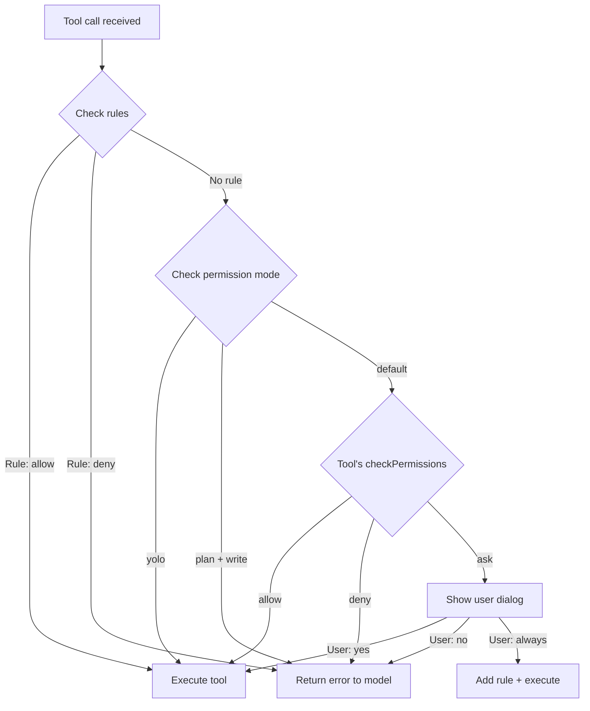

# 第 7 章：权限

## 问题

我们的智能体能运行任何 shell 命令。`rm -rf /`。`git push --force origin main`。用 `curl` 把你的源码发到某个莫名其妙的服务器。模型不会故意干这些事，但失误总会发生。而且有些任务确实需要危险操作。

你需要在“模型想做某事”和“这件事真的发生”之间设一道闸门。

## 实例：这条命令该不该运行？

模型想运行 `npm install express`。这安全吗？

看情况。如果用户要求“把 Express 加到项目里”，那就安全。如果用户要求“读一下 README”，那就不安全，模型不该擅自装包。

权限系统让用户来决定：

```
  [tool] run_command({ command: "npm install express" })

  智能体想要运行：npm install express
  允许吗？[y]是 / [n]否 / [a]总是允许这个模式
  > y

  [result] added 1 package...
```

用户看到了即将发生的事，并批准了它。如果他按了“n”，模型会收到一个错误，然后换一个思路试试。

## 三种决策

每次工具调用都会落到三种决策之一：

| 决策 | 会发生什么 |
|---|---|
| **allow** | 工具立即运行。不征询用户。 |
| **ask** | 用户看到这次工具调用，批准或拒绝。 |
| **deny** | 工具被拒绝，返回一条错误消息。不征询用户。 |

“allow”用于读文件之类的安全操作。“ask”用于可能有危险的操作。“deny”用于你永远不希望发生的事。

## 给工具加上 checkPermissions

我们给工具接口扩展一个 `checkPermissions` 方法：

```typescript
type PermissionDecision = "allow" | "ask" | "deny";

interface Tool {
  name: string;
  description: string;
  inputSchema: z.ZodObject<any>;
  call(input: Record<string, unknown>): Promise<string>;
  checkPermissions(input: Record<string, unknown>): PermissionDecision;
}
```

每个工具自己决定它需不需要权限：

```typescript
const readFileTool: Tool = {
  // ...
  checkPermissions() {
    return "allow"; // 读取始终安全
  },
};

const editFileTool: Tool = {
  // ...
  checkPermissions() {
    return "ask"; // 编辑文件需要批准
  },
};

const runCommandTool: Tool = {
  // ...
  checkPermissions(input) {
    const command = input.command as string;
    // 有些命令是安全的
    if (/^(ls|cat|echo|pwd|git status|git diff|git log)/.test(command)) {
      return "allow";
    }
    // 其他一律需要批准
    return "ask";
  },
};
```

run_command 工具最有意思。有些命令是只读的（比如 `ls` 或 `git status`），那些是安全的。其他一律给个“ask”。

## 权限模式

不同用户想要不同程度的掌控。有的想批准每一个动作。有的想让智能体自己放手去干。权限模式让用户来选：

```typescript
type PermissionMode = "default" | "plan" | "yolo";

// default: 写入和命令要征询，读取放行
// plan:    只读模式，拒绝所有写入和命令
// yolo:    什么都放行（危险，但对可信任务有用）
```

模式会覆盖单个工具的决策：

```typescript
function getEffectiveDecision(
  toolDecision: PermissionDecision,
  mode: PermissionMode
): PermissionDecision {
  switch (mode) {
    case "yolo":
      return "allow"; // 一切覆盖为放行
    case "plan":
      // 只放行只读操作
      if (toolDecision === "allow") return "allow";
      return "deny";
    case "default":
      return toolDecision; // 用工具自己的决策
  }
}
```

## 权限规则

除了模式，你还可以加一些具体规则。“总是允许 `npm test`。”“绝不允许 `rm`。”规则会针对特定模式覆盖默认行为。

```typescript
interface PermissionRule {
  toolName: string;
  pattern?: string; // 针对输入的正则模式
  decision: "allow" | "deny";
}

const rules: PermissionRule[] = [
  { toolName: "run_command", pattern: "^npm test", decision: "allow" },
  { toolName: "run_command", pattern: "^rm ", decision: "deny" },
];

function checkRules(
  toolName: string,
  input: Record<string, unknown>
): PermissionDecision | null {
  const inputStr = JSON.stringify(input);
  for (const rule of rules) {
    if (rule.toolName !== toolName) continue;
    if (rule.pattern && !new RegExp(rule.pattern).test(inputStr)) continue;
    return rule.decision;
  }
  return null; // 没有匹配的规则
}
```

规则会在工具自己的 `checkPermissions` 之前检查。如果有规则匹配，它优先。

## 权限对话框

当决策是“ask”时，我们向用户展示智能体想做什么：

```typescript
async function askUserPermission(
  toolName: string,
  input: Record<string, unknown>,
  rl: readline.Interface
): Promise<boolean> {
  const inputStr = JSON.stringify(input, null, 2);
  console.log(`\n  智能体想要使用：${toolName}`);
  console.log(`  输入：${inputStr}`);

  return new Promise((resolve) => {
    rl.question(
      "  允许吗？[y]是 / [n]否 / [a]总是允许这个工具 > ",
      (answer) => {
        const choice = answer.trim().toLowerCase();
        if (choice === "a" || choice === "always") {
          // 加一条会话规则，总是允许这个工具
          rules.push({ toolName, decision: "allow" });
          console.log(`  已添加规则：总是允许 ${toolName}`);
          resolve(true);
        }
        resolve(choice === "y" || choice === "yes");
      }
    );
  });
}
```

“always”选项会加一条会话规则，这样同一个工具就不会再反复问用户了。对重复性操作来说这很方便。在我们的例子里，这条规则只对当前会话有效（存在内存里）。

生产级智能体会更进一步。它们让用户把规则存到不同的地方：

- **会话** —— 在内存里，会话结束就没了
- **项目设置** —— 存到项目里的某个文件（比如 `.claude/settings.json`），与团队共享
- **用户设置** —— 存到全局配置文件（比如 `~/.claude/settings.json`），对所有项目生效

这样，用户就可以说“在这个项目里总是允许 `npm test`”，而且它会跨会话保留下来。

## 权限检查流程



## 把它接进循环

权限检查放在“模型请求工具”和“工具执行”之间：

```typescript
// 在智能体循环里，执行工具时：
for (const toolUse of toolUseBlocks) {
  const tool = tools.find((t) => t.name === toolUse.name);
  if (!tool) { /* 处理未知工具 */ continue; }

  // 权限检查（新增！）
  const ruleDecision = checkRules(tool.name, toolUse.input);
  const toolDecision = ruleDecision ?? tool.checkPermissions(toolUse.input);
  const finalDecision = getEffectiveDecision(toolDecision, permissionMode);

  if (finalDecision === "deny") {
    toolResults.push({
      type: "tool_result",
      tool_use_id: toolUse.id,
      content: "权限被拒绝。不允许此操作。",
      is_error: true,
    });
    continue;
  }

  if (finalDecision === "ask") {
    const allowed = await askUserPermission(tool.name, toolUse.input, rl);
    if (!allowed) {
      toolResults.push({
        type: "tool_result",
        tool_use_id: toolUse.id,
        content: "用户拒绝了权限。",
        is_error: true,
      });
      continue;
    }
  }

  // 执行工具（跟之前一样）
  const result = await tool.call(parsed.data);
  // ...
}
```

当一个工具被拒绝时，模型会收到一个错误，而不会崩溃。模型看到“权限被拒绝”，就能调整。也许它向用户求助，也许它换一个思路。循环继续。

## 还缺什么

我们的智能体把一切都放在一大段对话里跑。复杂任务有时拆开来做会更好。“探索代码库”和“做这处修改”是两件不同的事。下一章，我们会构建子代理，它们可以做隔离的工作，然后回来汇报。

## 运行示例

```bash
npm run example:07
```

试试：
- “读一下 Button 组件”（应该自动放行，不弹提示）
- “运行 npm --version”（应该征询权限）
- “删掉所有文件”（模型可能会试 `rm`，这应该会触发一次权限提示）
