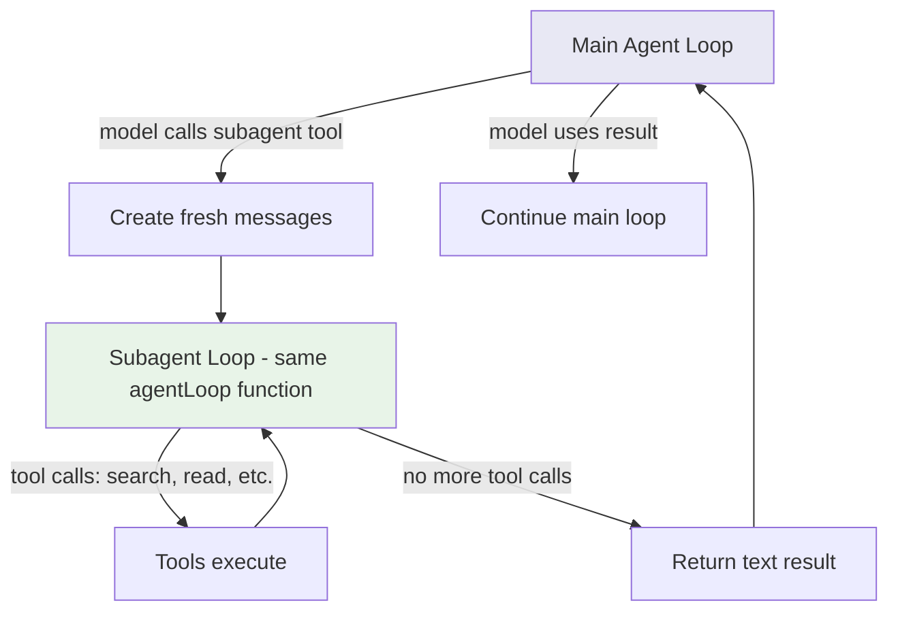

# 第 8 章：子代理

## 问题

你让智能体：“先更新 API，再更新测试，最后更新文档。”

智能体读了 10 个 API 文件、15 个测试文件、8 个文档文件。所有这些文件内容现在都在对话历史里了。等它干到文档那一步时，上下文里塞满了早已无关的 API 代码。

复杂任务里的子任务并不需要彼此的上下文。探索 API 不该污染写测试的上下文。写测试不该污染写文档的上下文。

## 什么是子代理？

子代理不过是同一个智能体循环的另一个实例，它跑在自己的对话历史上。主智能体通过调用一个工具（跟调用别的工具一样）把它派出去，给它一段提示词，等它完成后拿回一个文本结果。

核心思路是：子代理有它自己的 messages 数组。它的工具调用和结果都留在它自己的上下文里，不进父代理的。父代理只看到子代理返回的那段最终摘要。

它不是一个独立的程序或进程。它就是用一个全新的 messages 数组调用的那同一个 `agentLoop()` 函数。

## 实例：委派一个搜索任务

主智能体收到：“找出所有用到 Button 组件的组件，然后告诉我它们的情况。”

它不自己去搜（那样会把结果灌进它自己的上下文），而是委派出去：

```
Main agent:
  [tool] subagent({
    prompt: "搜索所有 import 了 Button 的文件。读每一个，
             并总结它拿 Button 组件做了什么。"
  })

  Subagent (它自己的循环):
    [tool] search_files({ pattern: "import.*Button", directory: "src" })
    [tool] read_file("src/pages/Home.tsx")
    [tool] read_file("src/pages/Settings.tsx")
    [tool] read_file("src/pages/Profile.tsx")
    返回: "找到 3 个组件：Home 用 Button 做导航，
             Settings 用它做表单提交，Profile 用它
             做编辑动作。"

Main agent 收到: "找到 3 个组件：Home 用 Button 做……"
```

主智能体的上下文保持干净。它只看到那段摘要，看不到子代理读的那 3 个完整文件。所有繁重的读取，子代理都在它自己隔离的上下文里干完了。

## 同一个函数，隔离的上下文

子代理不是一个独立的程序。它就是我们在第 1 章里构建的那同一个智能体循环，只不过是用一个全新的 messages 数组来调用：

```typescript
async function runSubagent(prompt: string): Promise<string> {
  // 全新的对话，只有这段提示词
  const subagentMessages: Anthropic.MessageParam[] = [
    { role: "user", content: prompt },
  ];

  // 用隔离的 messages 跑同一个智能体循环
  return agentLoop(subagentMessages);
}
```

这就是核心思路。子代理调用的是同一个 `agentLoop()` 函数。它能用同一套工具（读、改、搜等等）。但它有自己的对话历史。它的工具结果不会渗进父代理的上下文。

## 共享还是隔离

不是所有东西都隔离。有些东西需要共享：

| 组件 | 共享还是隔离 | 原因 |
|---|---|---|
| **Messages** | 隔离 | 这正是重点所在。让上下文彼此分开。 |
| **文件读取缓存** | 克隆 | 子代理拿到一份父代理到目前为止读过的东西的副本（用于陈旧性检查）。子代理的新读取不会回流到父代理。 |
| **Tools** | 共享 | 两者用同一套工具。 |
| **中止信号** | 联动 | 如果用户取消，父子都应该停下。 |
| **权限规则** | 共享 | 如果用户说过“总是允许 edit_file”，那对子代理也同样生效。 |

我们是这样搭起来的：

```typescript
async function runSubagent(
  prompt: string,
  parentAbortSignal?: AbortSignal
): Promise<string> {
  // 创建一个与父代理联动的子 abort controller
  const childAbort = new AbortController();
  if (parentAbortSignal) {
    parentAbortSignal.addEventListener("abort", () => childAbort.abort());
  }

  // messages 全新，但其他一切共享
  const subagentMessages: Anthropic.MessageParam[] = [
    { role: "user", content: prompt },
  ];

  return agentLoop(subagentMessages);
}
```

messages 是全新的。中止信号是联动的（父代理取消会把子代理也杀掉）。其他一切（工具、权限、文件状态）都是共享的，因为它们活在模块作用域里。

## 子代理工具

子代理本身就是一个模型可以调用的工具：

```typescript
const subagentTool: Tool = {
  name: "subagent",
  description:
    "把一个任务委派给子代理。子代理在它自己的上下文里运行，" +
    "并返回一段摘要。用它来做探索、调研，或者那些会把你的" +
    "主上下文搞乱的子任务。",
  inputSchema: z.object({
    prompt: z.string().describe("交给子代理执行的任务"),
  }),
  checkPermissions() {
    return "allow"; // 子代理沿用同一套权限规则
  },
  async call(input) {
    const prompt = input.prompt as string;
    console.log("  [subagent] 启动中……");
    const result = await runSubagent(prompt);
    console.log("  [subagent] 完成。");
    return result;
  },
};
```

模型自己决定何时用子代理。它不过是工具箱里的又一个工具。对庞大的探索型任务，它委派出去。对简单、专注的任务，它直接动手。

## 实际看起来是怎样的



父代理和子代理都跑 `agentLoop()`。子代理的工具调用和结果留在它自己的上下文里。父代理只看到子代理返回的那段最终文本。

## 什么时候用子代理

子代理适用于：

- **探索**：“找出所有和认证相关的文件”，而不用把 20 个文件读取灌进主上下文
- **多部分任务**：把“更新 API”和“更新测试”作为两次独立的子代理调用
- **后台调研**：查找模式、读文档文件、理解代码结构
- **有风险的实验**：如果子代理的思路失败了，主上下文也不会被失败的尝试污染

子代理不适用于：

- **简单任务**：读一个文件、做一处修改。子代理的开销不值当。
- **需要父代理上下文的任务**：如果子代理需要知道父代理已经讨论过什么，你反正还得把那段上下文传过去，这就失去了意义。

## 最大轮数

子代理的轮数上限应该比主智能体更紧。一个失控的子代理能很快烧掉 token。给子代理设 10-15 轮的上限，相对于主智能体的 20-30 轮：

```typescript
async function runSubagent(prompt: string): Promise<string> {
  const messages: Anthropic.MessageParam[] = [
    { role: "user", content: prompt },
  ];
  return agentLoop(messages, { maxTurns: 10 });
}
```

## 还缺什么

我们的智能体能用了，但用户体验还很糙。模型思考时，用户盯着一块空屏幕。它在读一个大文件时，好几秒钟什么都没有。下一章，我们会加上流式输出，让用户在回复生成的同时就能一个 token 一个 token 地看到它。

## 运行示例

```bash
npm run example:08
```

试试：
- “用一个子代理找出 sample-project 里的所有组件，并逐个描述”
- “sample-project 里每个文件是干什么的？”（模型可能会把这次探索委派出去）
