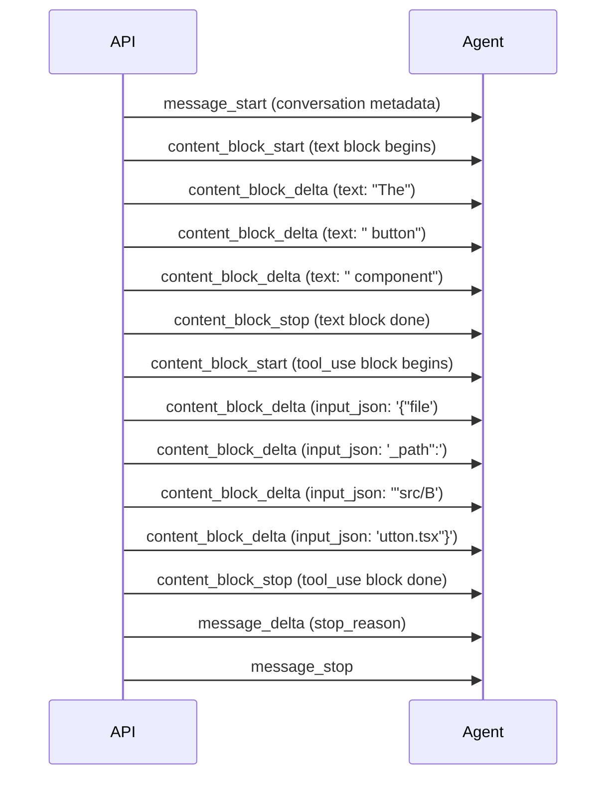

# 第 9 章：流式输出

## 问题

没有流式输出时，用户发完消息就只能盯着一块空屏幕。模型可能要花 5-10 秒才能生成回复。如果它要调用工具，模型得先把完整的工具输入生成出来，然后才会有动静。接着工具执行。接着模型再生成更多文本。在这一切结束之前，用户什么都看不到。

流式输出解决了这个问题。文本随着模型生成一个字一个字地冒出来。用户知道智能体在干活。他们可以在回复还没完成时就开始读。

## 流式输出是怎么工作的

我们不用返回完整回复的 `client.messages.create()`，而是用 `client.messages.stream()`，它随着事件发生而逐个返回它们：

```typescript
const stream = client.messages.stream({
  model: "claude-sonnet-4-20250514",
  max_tokens: 4096,
  messages: conversationHistory,
  tools: apiTools,
});
```

这个流会按如下顺序发出事件：



## 事件类型

| 事件 | 含义 |
|---|---|
| `message_start` | 回复开始了。包含元数据。 |
| `content_block_start` | 一个新的内容块开始了（text 或 tool_use）。 |
| `content_block_delta` | 一小块内容。对文本来说：几个词。对工具输入来说：一段 JSON。 |
| `content_block_stop` | 当前内容块结束了。 |
| `message_delta` | 收尾的元数据，比如 `stop_reason` 和 token 用量。 |
| `message_stop` | 回复完成了。 |

## 流式输出文本

文本增量很简单。每个 `type: "text_delta"` 的 `content_block_delta` 事件都带着一小段文本。立刻把它打印出来：

```typescript
for await (const event of stream) {
  if (
    event.type === "content_block_delta" &&
    event.delta.type === "text_delta"
  ) {
    process.stdout.write(event.delta.text); // 不带换行地打印
  }
}
```

用户会看到文本一个词一个词地冒出来。即便总耗时一样，这也比干等完整回复感觉快得多。

## 流式输出工具输入

工具输入要棘手一些。模型是逐步生成工具的 JSON 输入的。每个 `input_json_delta` 事件都带着 JSON 字符串的一小片：

```
Delta 1: '{"file'
Delta 2: '_path":'
Delta 3: '"src/'
Delta 4: 'Button.tsx"}'
```

不完整的 JSON 是没法解析的。所以你把这些增量缓冲起来，等块完整了再解析：

```typescript
let toolInputBuffer = "";

for await (const event of stream) {
  if (event.type === "content_block_start" && event.content_block.type === "tool_use") {
    toolInputBuffer = "";  // 为新工具重置缓冲区
  }

  if (event.type === "content_block_delta" && event.delta.type === "input_json_delta") {
    toolInputBuffer += event.delta.partial_json;  // 缓冲这些片段
  }

  if (event.type === "content_block_stop") {
    // 现在可以解析完整的 JSON 了
    const input = toolInputBuffer ? JSON.parse(toolInputBuffer) : {};
    // 用解析出的输入执行工具
  }
}
```

## 为流式输出重写循环

智能体循环从 `create()` 改成 `stream()`。我们需要把完整回复累积起来（用于对话历史），同时又把文本流式地推给用户：

```typescript
async function agentLoop(messages: Anthropic.MessageParam[]): Promise<string> {
  while (true) {
    const stream = client.messages.stream({
      model: "claude-sonnet-4-20250514",
      max_tokens: 4096,
      system: SYSTEM_PROMPT,
      tools: apiTools,
      messages,
    });

    // 为对话历史累积完整回复
    const contentBlocks: Anthropic.ContentBlock[] = [];
    let currentToolInput = "";
    let currentToolId = "";
    let currentToolName = "";

    for await (const event of stream) {
      switch (event.type) {
        case "content_block_start":
          if (event.content_block.type === "text") {
            contentBlocks.push({ ...event.content_block, text: "" });
          } else if (event.content_block.type === "tool_use") {
            currentToolId = event.content_block.id;
            currentToolName = event.content_block.name;
            currentToolInput = "";
          }
          break;

        case "content_block_delta":
          if (event.delta.type === "text_delta") {
            // 立刻把文本流式推给用户
            process.stdout.write(event.delta.text);
            // 同时为历史累积
            const lastBlock = contentBlocks[contentBlocks.length - 1];
            if (lastBlock?.type === "text") {
              lastBlock.text += event.delta.text;
            }
          } else if (event.delta.type === "input_json_delta") {
            currentToolInput += event.delta.partial_json;
          }
          break;

        case "content_block_stop":
          if (currentBlockType === "tool_use") {
            contentBlocks.push({
              type: "tool_use",
              id: currentToolId,
              name: currentToolName,
              input: currentToolInput ? JSON.parse(currentToolInput) : {},
            });
            currentToolInput = "";
          }
          currentBlockType = null;
          break;
      }
    }

    // 把完整回复加进历史
    messages.push({ role: "assistant", content: contentBlocks });

    // 检查是否有工具调用（跟之前一样）
    const toolBlocks = contentBlocks.filter(b => b.type === "tool_use");
    if (toolBlocks.length === 0) {
      return contentBlocks
        .filter((b): b is Anthropic.TextBlock => b.type === "text")
        .map(b => b.text).join("\n");
    }

    // 执行工具并继续（跟之前一样）
    // ...
  }
}
```

关键改动在内层循环。我们遍历流事件，而不是等一个完整回复。文本一到就打印。工具输入则缓冲到完整为止。

## 用户看到的是什么

没有流式输出时：
```
> Button 组件是干什么的？
(停顿 10 秒……)
Button 组件接受一个 label 和一个 onClick 处理函数……
```

有流式输出时：
```
> Button 组件是干什么的？
  [tool] read_file({"file_path":"sample-project/src/components/Button.tsx"})
  [result] 1  interface ButtonProps { ...
Button| 组件| 接受| 一个| label| 和| 一个| onClick| 处理函数|……
```

每个 `|` 代表一小块新内容冒出来的位置。用户看到回复实时地一点点搭起来。

## 使用 SDK 的辅助工具

大多数 LLM SDK 都提供了流式输出的辅助工具。比如，Anthropic SDK 有一个 `finalMessage()` 辅助方法，能在流式输出结束后拿到完整回复：

```typescript
const stream = client.messages.stream({ ... });

// 把文本流式推给用户
stream.on("text", (text) => {
  process.stdout.write(text);
});

// 结束时拿到完整消息
const finalMessage = await stream.finalMessage();
```

对简单场景来说这样更省事。但对我们的智能体循环，我们需要更多控制（要在流式输出过程中检测 tool_use 块），所以才用原始事件那套做法。

## 流式输出思考块

现在许多 LLM 都支持“思考”或“推理”，也就是模型在回复之前把它的思考过程展示出来。开启后，模型会在 `text` 或 `tool_use` 块之前产出一个 `thinking` 内容块。

思考块的流式方式跟文本一样，只是 delta 类型不同：

- `type: "thinking"` 的 `content_block_start` 表示一个思考块开始
- `type: "thinking_delta"` 的 `content_block_delta` 带着模型推理的一小块块
- `content_block_stop` 结束这个思考块

```typescript
case "content_block_start":
  if (event.content_block.type === "thinking") {
    // 一个思考块开始了
    console.log("  [思考中……]");
  }
  break;

case "content_block_delta":
  if (event.delta.type === "thinking_delta") {
    // 模型在推理。你可以展示它，也可以藏起来。
    // 有的智能体显示一个转圈动画，有的把完整思考过程亮出来。
    process.stdout.write(event.delta.thinking);
  }
  break;
```

要不要把思考展示给用户，是一个设计选择。有的智能体把它放在一个可折叠的区块里。有的显示一个带着“思考中……”的转圈动画，把内容藏起来。有的干脆跳过。智能体循环要正常工作，思考块并不需要进对话历史。真正要紧的是 `text` 和 `tool_use` 块。

有一点要注意：有些提供方还有“脱敏思考”块，也就是模型思考过某件事，但内容对你是隐藏的。你会拿到一个 `type: "redacted_thinking"` 的块，却没有实际文本。认一下它，然后往下走就行。

## 还缺什么

当模型一次调用 3 个工具时（比如读 3 个文件），我们是一个一个执行的。但 Read 是一个安全的只读操作。我们完全可以把这 3 个并行跑，省点时间。这就是下一章的主题。

## 运行示例

```bash
npm run example:09
```

留意文本是如何逐步冒出来、而不是一下子全出来的。把这个体验跟前面的例子比一比。
