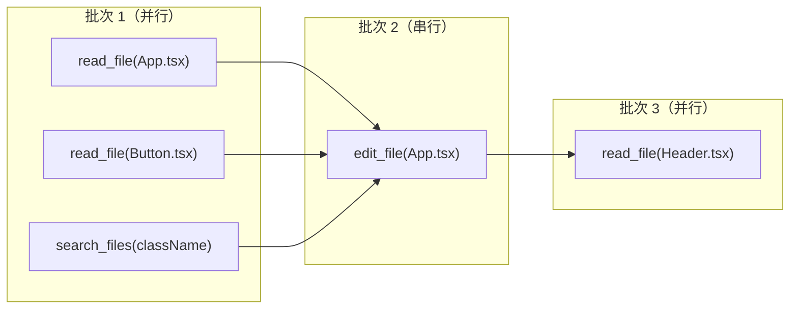

# 第 10 章：并发执行工具

## 问题所在

在前面几章里，模型通常每一轮只调用一个工具。它调用 `read_file`，拿到结果，再决定下一步做什么。但模型其实也可以在**一轮里调用多个工具**。响应里不再只有一个 `tool_use` 块，而是返回好几个：

```json
{
  "content": [
    { "type": "tool_use", "name": "read_file", "input": { "file_path": "A.tsx" } },
    { "type": "tool_use", "name": "read_file", "input": { "file_path": "B.tsx" } },
    { "type": "tool_use", "name": "read_file", "input": { "file_path": "C.tsx" } }
  ]
}
```

模型的意思是：“这三个文件我都要，帮我取过来。”我们的循环已经能处理这种情况了。还记得第 1 章里那个逐个执行工具的 `for` 循环吗？

```typescript
for (const toolUse of toolUseBlocks) {
  const result = await tool.call(toolUse.input);  // 逐个等待
  toolResults.push({ ... });
}
```

因为有 `await`，它一次只跑一个。每个工具都得等上一个跑完。读一个文件要 50ms，三次就是 150ms。如果同时跑，只要 50ms，快了三倍。

那 `edit_file` 呢？如果两次编辑改的是同一个文件，并行执行可能会把文件搞坏——一次编辑把另一次的结果覆盖掉。

所以我们得知道哪些工具可以安全并行，哪些不行。

## 并发安全标志

每个工具都声明自己能否和其他工具同时运行：

```typescript
interface Tool {
  name: string;
  // ... 其他字段
  isConcurrencySafe: boolean;
}
```

规则很简单：

| 工具 | 可并发？ | 原因 |
|---|---|---|
| read_file | 是 | 读取不改变状态 |
| list_files | 是 | 列目录不改变状态 |
| search_files | 是 | 搜索不改变状态 |
| edit_file | 否 | 两次编辑可能冲突 |
| write_file | 否 | 两次写入可能冲突 |
| run_command | 通常否 | 命令可能改变状态、影响文件系统、共享环境 |

只读工具可以安全并行，改变状态的工具不行。

实际上，这个标志可以取决于输入。像 `cat file.txt` 这样的 shell 命令是只读的，并行也没问题。生产级智能体会判断命令是否只读，是的话就允许并发。为了简单起见，我们把所有 shell 命令都标记为不安全。你以后可以再细化。

## 拆分成批次

当模型在一个响应里返回多个工具调用时，我们把它们分成若干批次：

```
模型返回的工具调用（一个响应里有 5 个调用）：

  1. read_file("src/App.tsx")
  2. read_file("src/components/Button.tsx")
  3. search_files("className")
  4. edit_file("src/App.tsx", ...)
  5. read_file("src/components/Header.tsx")

拆分后的批次：

  批次 1：[read_file, read_file, search_files]  ← 都安全，并行执行
  批次 2：[edit_file]                            ← 不安全，单独执行
  批次 3：[read_file]                            ← 安全，但必须等编辑完成
```

算法从左到右遍历这些工具调用：

```typescript
interface Batch {
  tools: ToolCall[];
  concurrent: boolean;
}

function partitionIntoBatches(toolCalls: ToolCall[]): Batch[] {
  const batches: Batch[] = [];
  let currentBatch: ToolCall[] = [];
  let currentIsConcurrent = true;

  for (const call of toolCalls) {
    const tool = tools.find(t => t.name === call.name);
    const isSafe = tool?.isConcurrencySafe ?? false;

    if (isSafe && currentIsConcurrent) {
      // 加入当前并发批次
      currentBatch.push(call);
    } else {
      // 当前批次有内容就先收尾
      if (currentBatch.length > 0) {
        batches.push({ tools: currentBatch, concurrent: currentIsConcurrent });
      }
      // 开启新批次
      currentBatch = [call];
      currentIsConcurrent = isSafe;
    }
  }

  // 收尾最后一个批次
  if (currentBatch.length > 0) {
    batches.push({ tools: currentBatch, concurrent: currentIsConcurrent });
  }

  return batches;
}
```

拿前面的例子来说，输出大概长这样：

```typescript
[
  {
    concurrent: true,
    tools: [
      { name: "read_file", input: { file_path: "src/App.tsx" } },
      { name: "read_file", input: { file_path: "src/components/Button.tsx" } },
      { name: "search_files", input: { pattern: "className" } },
    ]
  },
  {
    concurrent: false,
    tools: [
      { name: "edit_file", input: { file_path: "src/App.tsx", ... } },
    ]
  },
  {
    concurrent: true,
    tools: [
      { name: "read_file", input: { file_path: "src/components/Header.tsx" } },
    ]
  },
]
```

三个批次。第一个和第三个批次里的工具可以并行跑，第二个批次单独跑。

## 执行批次

并发批次用 `Promise.all()`。非并发批次则一次只跑一个工具：

```typescript
async function executeBatches(batches: Batch[]): Promise<ToolResult[]> {
  const allResults: ToolResult[] = [];

  for (const batch of batches) {
    if (batch.concurrent) {
      // 这个批次里的工具全部同时执行
      const results = await Promise.all(
        batch.tools.map(call => executeTool(call))
      );
      allResults.push(...results);
    } else {
      // 一次只跑一个工具
      for (const call of batch.tools) {
        const result = await executeTool(call);
        allResults.push(result);
      }
    }
  }

  return allResults;
}
```

我们的批次方案很简单，也很好用。生产级智能体常用另一种机制：**队列**。它们不预先把工具分批，而是遍历一个排队的工具列表，条件允许就启动一个。它问的是：“这个工具现在能跑吗？”如果当前正在运行的工具都是安全的，而且这个工具也安全，就启动它；否则就等待。

结果是一样的（安全工具一起跑，不安全工具单独跑），但队列方式能更好地处理执行过程中陆续到来的工具，因为流式输出可能在前面的工具还在跑的时候，一个一个地送来新的工具调用。

出于学习目的，分批更好理解。队列方式是你以后可以切换过去的一种优化。

## 图示



批次 1 同时跑三个读取/搜索。三个都完成后，批次 2 单独跑那个编辑。然后批次 3 跑最后那个读取。

## 保持顺序

虽然并发批次里的工具会在不同时刻完成，但返回结果必须按原始顺序排列。模型期望结果和它发出的工具调用顺序一一对应。

`Promise.all()` 已经帮我们处理好了。它按输入 promise 的顺序返回结果，不管哪个先 resolve。

```typescript
const results = await Promise.all([
  read_file("src/App.tsx"),              // 第 3 个完成（大文件）
  read_file("src/components/Button.tsx"), // 第 1 个完成（小文件）
  search_files("className"),             // 第 2 个完成
]);

// results[0] = App.tsx 内容（对应输入顺序，而非完成顺序）
// results[1] = Button.tsx 内容
// results[2] = 搜索结果
```

## 错误处理

当批次里的某个工具失败时，其他工具会怎样？

对只读工具来说，错误互相独立。如果 `read_file("App.tsx")` 失败而 `read_file("Button.tsx")` 成功，没有问题——一个返回错误，另一个返回结果就行。

对 shell 命令就不一样了。如果批次里有个失败的 `run_command`（比如一个构建步骤），同批次里的其他工具可能处于不一致的状态。生产级智能体会在 shell 命令失败时中止同批次的其他工具。

在我们这个简化版里，让每个工具自己处理自己的错误：

```typescript
const results = await Promise.all(
  batch.tools.map(async (call) => {
    try {
      return await executeTool(call);
    } catch (err) {
      return { toolUseId: call.id, content: `错误：${err}`, isError: true };
    }
  })
);
```

每个工具调用都包在 try/catch 里。一个失败不会影响其他的。

## 接入循环

前面几章里，我们在 `for` 循环里一次只执行一个工具。现在把它换成批次执行，改动很小：

```typescript
// 改之前（串行）：
for (const toolUse of toolBlocks) {
  const tool = tools.find(t => t.name === toolUse.name);
  const result = await tool.call(toolUse.input);
  toolResults.push({ type: "tool_result", tool_use_id: toolUse.id, content: result });
}

// 改之后（并发）：
const toolCalls = toolBlocks.map(block => ({
  block,
  tool: tools.find(t => t.name === block.name),
  input: block.input,
}));
const batches = partitionIntoBatches(toolCalls);
const toolResults = await executeBatches(batches);
```

智能体循环里的其他部分都不变。工具结果照样作为一条用户消息推进对话。循环照样检查有没有 tool_use 块来决定是否继续。唯一的区别，是这两步之间工具的执行方式变了。

## 性能提升

提升的幅度取决于具体的工作负载：

| 场景 | 串行 | 并发 | 加速 |
|---|---|---|---|
| 读 3 个小文件 | 150ms | 50ms | 3 倍 |
| 读取 + 搜索 + 列目录 | 200ms | 80ms | 2.5 倍 |
| 读 1 个文件、改 1 个文件 | 100ms | 100ms | 1 倍（无法并行） |
| 5 次读取 + 1 次编辑 + 3 次读取 | 450ms | 200ms | 2.25 倍 |

并发安全的工具批次越大，收益越大。如果模型主要是读取和搜索（探索阶段很常见），并发带来的差别相当明显。

## 还缺什么

核心智能体已经完整了，但它只能处理本地文件。下一章我们给它访问网络的能力，让它可以查文档、搜索解决方案、阅读在线参考资料。

## 运行示例

```bash
npm run example:10
```

让智能体读多个文件，然后观察日志。并发读取会在一个批次里一起执行，而不是一个一个来：

```
  [batch] Executing 3 tools concurrently
  [tool] read_file("src/App.tsx")
  [tool] read_file("src/components/Button.tsx")
  [tool] read_file("src/components/Header.tsx")
  [batch] All 3 completed
```
