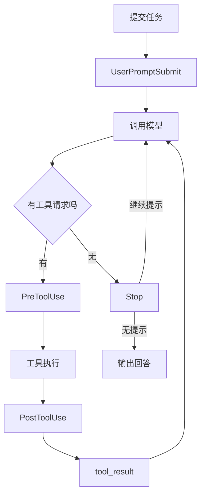

# 第 14 章：Hook，把扩展放在明确的位置

## 为什么现在才抽出扩展点

到第 12 章，我们已经看过完整循环和多种能力。此时再加入日志、权限规则、停止条件，如果每次都直接修改循环，它就会越来越难读。

Hook 只是“运行到某个时机，按顺序调用几段函数”。它不决定模型选择哪个工具，也不替模型做任务规划。先理解循环，再为循环留出插口，这个顺序比第一章就引入一套运行时更容易跟上。

本章只保留 `read_file` 和 `write_file` 两个基础工具。完整示例在 [14-with-hooks.ts](../examples/14-with-hooks.ts)，包含类型、工具、执行入口、循环和终端输入；没有课程内部模块需要跳转。

## 四个时机分别负责什么

| 时机 | 发生在何时 | 适合接什么 |
|---|---|---|
| `UserPromptSubmit` | 把用户输入加入历史之前 | 记录任务、补充工作区信息 |
| `PreToolUse` | 实际执行工具之前 | 权限判断、参数策略 |
| `PostToolUse` | 工具成功返回之后 | 输出日志、进度计数 |
| `Stop` | 模型这一轮没有工具请求时 | 判断是否还需要继续 |

可以把它画成一条很短的执行路径：



## 回调按顺序执行

注册时，事件名称对应一个回调数组。触发时逐个 `await`，前一个回调可以影响后一个回调是否还有必要执行。

```typescript
export async function trigger(hooks: Map<HookEvent, Hook[]>, event: HookEvent, context: HookContext) {
  for (const hook of hooks.get(event) ?? []) {
    const result = await hook(context);
    if (typeof result === "string" && result.trim()) return result;
  }
}
```

这里约定：没有返回值，表示当前回调不阻止流程；返回字符串，表示当前事件需要提前结束。字符串的含义由调用位置决定。`PreToolUse` 将它当作拒绝理由，`Stop` 将它当作下一轮提示。

这个约定刻意简单。生产系统可以使用结构化返回值；先理解两个控制点已经足够。

## 权限必须挡在执行器前面

示例拒绝写入以 `.env` 开头的文件。规则接在 `PreToolUse`，实际 handler 只有在没有拒绝原因时才会被调用。

```typescript
const reason = await trigger(hooks, "PreToolUse", context);
if (reason) return `Error: ${reason}`;
```

错误字符串仍会变成当前工具请求的 `tool_result`。模型知道操作被拒绝，可以选择其他行动；消息协议不会因为拒绝而断开。

这只是一个教学策略。其他文件工具仍具有真实读写能力，规则也没有建立操作系统沙箱。需要实际隔离时，应在工作目录、进程权限和执行环境上实施限制。

## PostToolUse 观察已经发生的事

执行器先得到真实结果，然后触发 `PostToolUse`。日志因此记录的是实际输出，不是模型声称自己做过的工作。

如果 handler 抛出异常，执行入口会返回 `Error:`。本示例不会对失败执行触发成功后的 Hook；要统一记录错误，可以另加失败事件，或者在执行入口的 `finally` 中记录。

## Stop 允许循环继续，但必须有限

模型没有提出工具请求时，循环通常结束。`Stop` 可以指出仍有工作未完成，比如待办没有收尾，或后台测试还没有结果。

```typescript
const continuation = await trigger(hooks, "Stop", { messages });
if (continuation) {
  messages.push({ role: "user", content: continuation });
  continue;
}
```

返回的提示进入下一轮，模型继续决定行动。每轮仍计入 `maxTurns`，因此反复返回继续提示不会形成无限循环。

## 跑一下

在仓库根目录执行：

```bash
pnpm run example:14 -- --prompt "用 write_file 创建 hook-demo.txt，写入你好，再读取确认。"
```

你应该看到工具调用与真实结果日志。随后运行：

```bash
pnpm run example:14 -- --prompt "用 write_file 写入 .env-demo，内容为测试。"
```

写入会被拒绝，磁盘上不应新增 `.env-demo`。拒绝结果仍返回给模型。

还可以在 `createAgent()` 的注册位置加一个 `Stop` 回调：第一次返回“再读取 hook-demo.txt 核对一次”，以后返回空值。观察一次额外轮次，就能看到停止检查如何接回同一个循环。

## 下一步

下一章使用相同的扩展时机，为模型增加一个用户能看到的待办清单。Hook 是插口，待办是接在插口上的具体状态。

[上一章：接下来呢](13-whats-next.md) · [下一章：待办管理](15-todo-planning.md)
