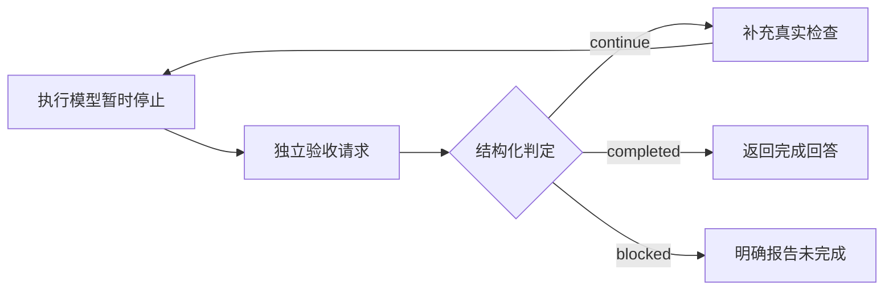

# 第 23 章：独立目标验收

本章完整示例：[23-with-goals.ts](../examples/23-with-goals.ts)。请先读前一章，再沿着本文件中的 `createAgent → execute → agentLoop` 路径阅读。

## 完成回答不等于目标已完成

模型给出最终文本，只表示它这轮没有请求工具。GoalMonitor 在这个时机发起独立验收请求，比较用户目标与 execute 保存的真实结果。验收者不接收执行模型的 assistant 自述，减少把自我评价当证据的机会。

## 证据来自工具执行入口

execute 在 handler 返回后记录工具名、校验后的输入和实际输出，并分配不可由模型指定的证据 id。Error: 不会入库。最终验收引用 evidence_ids，程序检查 id 确实存在；口头说“测试通过”不会产生测试证据。

## 验收本身也需要校验

独立请求使用 FAST_MODEL、没有工具，只接受严格 JSON。status 只能是 completed、continue、blocked，必须给 reason。完成至少引用一个读取或检查工具的结果；只有写入回执不足。无效 JSON、假证据 id 或超时会向 CLI 报错，绝不默认为成功。

## 继续、阻塞和预算

验收请求的上下文只有这一条用户消息：

```typescript
messages: [{
  role: "user",
  content: JSON.stringify({ goal: this.goal, evidence: this.evidence }),
}]
```



程序还会拒绝把仍运行或失败的 `background_status` 当作成功检查，也不会接受无效、截断的工作流完成结果。

continue 会把验收意见加入原 messages，执行模型补齐证据后再验收。blocked 返回明确未完成状态。默认最多 3 次验收、主循环最多 20 轮，验收请求另有 30 秒信号限制。--goal 可给出比用户行动描述更明确的验收条件；每次用户提交会新建验收状态。

## 独立请求的能力边界

执行与验收可以使用相同模型标识，但必须是隔离上下文的两次请求；FAST_MODEL 可以单独配置。LLM 验收依然会误判，证据 id 校验也只证明结果真实存在，不能数学证明任意目标。关键业务应进一步用固定断言、编译器或测试结果做确定性验收。

## 亲手验证

先运行 --demo，看到缺少读取时 continue、补充读取后 completed；这明确使用注入判定器，只验证控制流程。真实 --prompt 会同时调用 MODEL 与 FAST_MODEL，并在终端显示验收 JSON。测试会额外构造假 id、无效 JSON 和没有工具证据的完成声明，确认全部被拒绝。

## 运行入口

在仓库根目录完成依赖安装并配置 `.env` 后运行：

```bash
pnpm run example:23 -- --help
pnpm run example:23 -- --prompt "创建 goal-demo.txt 内容为 GOAL_OK，然后读取核对。"
```

不传 `--prompt` 则进入交互终端，输入 `q` 或 `exit` 退出。工具具有实际读写能力；建议复制示例到练习目录，或为导出的 `createAgent` 传入临时 `cwd`。

机制演示不需要 API key，可直接运行：

```bash
pnpm exec tsx examples/23-with-goals.ts --demo
```

项目的 `pnpm run example:23` 脚本仍读取 `.env`，因此没有环境文件时请使用上面的直接入口。

## 阅读检查点

- 在 `tools` 数组中找出本章新增的工具及其模型 Schema。
- 在 `execute` 中找出参数校验、实际执行和错误转成 `tool_result` 的路径。
- 在 `agentLoop` 中确认模型响应先写入历史，每个 `tool_use_id` 都有对应结果。
- 区分内存状态与磁盘状态，说明退出后哪些内容仍会保留。
- 故意制造一次失败，核对终端、工具结果与真实状态是否一致。

[上一章](22-workflows.md) · [下一章：把能力接回同一个循环](24-integrated-agent.md)
