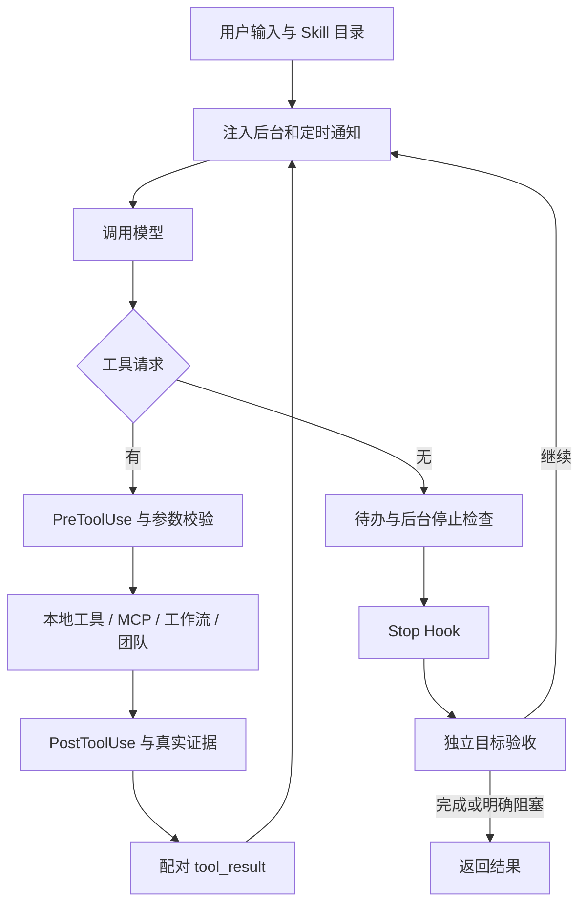

# 第 24 章：把能力接回同一个循环

本章完整示例：[24-integrated-agent.ts](../examples/24-integrated-agent.ts)。请先读前一章，再沿着本文件中的 `createAgent → execute → agentLoop` 路径阅读。

## 先找到循环，再看外围状态

本章把第 14～23 章的能力放入一个完整文件，作为可运行的组合参考。文件较长，是为了让你能从工具调用一直追到实际 handler。各能力的概念仍应回到对应短章学习；这份综合示例没有内部 AgentSession 或 shared/runtime 依赖。

## 沿一条任务路径阅读

先搜索 createAgent，再看 tools、execute、agentLoop。执行前触发 PreToolUse，执行后触发 PostToolUse 并收集目标证据；主循环调用模型前注入后台和定时通知；没有工具请求时先检查待办与后台任务，再触发 Stop，最后进入独立验收。这里只保留组合所需的三个 Hook，提交阶段直接初始化 goal 和 Skill 目录。

## 状态归属决定组合方式



沿一次 `workflow_run` 调用，把这条路径从头走到尾，比一口气记住所有类更有用。

TodoList、消息历史、后台进程、当前目标归属于实例；Skills 来源于工作区；任务、邮箱、cron、workflow 状态写在各自目录。MCP 连接也是实例资源，退出要关闭。两个 createAgent 实例不会共享 messages，但同一个 cwd 下的持久任务会共享磁盘状态，这就是锁仍有必要的原因。

## 组合不意味着自动调用全部能力

简单读文件任务不需要创建团队或 cron。模型根据工具描述选择能力；本章为了展示真实发现，会在启动时连接本地 MCP 服务，但不自动调用其工具。待办停止检查不要求未来定时任务全部执行，也不要求其他成员的任务全部完成，否则交互终端永远无法正常结束。

## 练习一个有明确验收条件的任务

使用下面的命令，预期先建立待办，再 workflow_run 写入与断言，随后 read_file 核对，最后更新 completed 并通过独立验收。第二次使用同一工作流 id 时应该复用真实文件仍符合预期的步骤。综合文件也导出 createAgent，可注入模型与验收器做离线控制流程测试。

## 哪些能力仍需要更强的实现

这是一份教学组合：文件权限不是操作系统沙箱，团队身份来自本地环境，任务版本不代表代码内容版本，cron 是至少一次，工作流只注册三种文件 action，目标判断依赖 LLM。LSP、TUI、完整网络权限与远程队列仍是后续工程方向。不要把一份综合示例的可运行性理解成生产系统全部完成。

## 运行入口

在仓库根目录完成依赖安装并配置 `.env` 后运行：

```bash
pnpm run example:24 -- --help
pnpm run example:24 -- --prompt "列出创建 final-demo.txt 的待办，用工作流写入 FINAL_OK 并断言，再读取文件核对，完成待办。"
```

不传 `--prompt` 则进入交互终端，输入 `q` 或 `exit` 退出。工具具有实际读写能力；建议复制示例到练习目录，或为导出的 `createAgent` 传入临时 `cwd`。

## 阅读检查点

- 在 `tools` 数组中找出本章新增的工具及其模型 Schema。
- 在 `execute` 中找出参数校验、实际执行和错误转成 `tool_result` 的路径。
- 在 `agentLoop` 中确认模型响应先写入历史，每个 `tool_use_id` 都有对应结果。
- 区分内存状态与磁盘状态，说明退出后哪些内容仍会保留。
- 故意制造一次失败，核对终端、工具结果与真实状态是否一致。

[上一章](23-goals.md) · [返回课程目录](../README.md)
